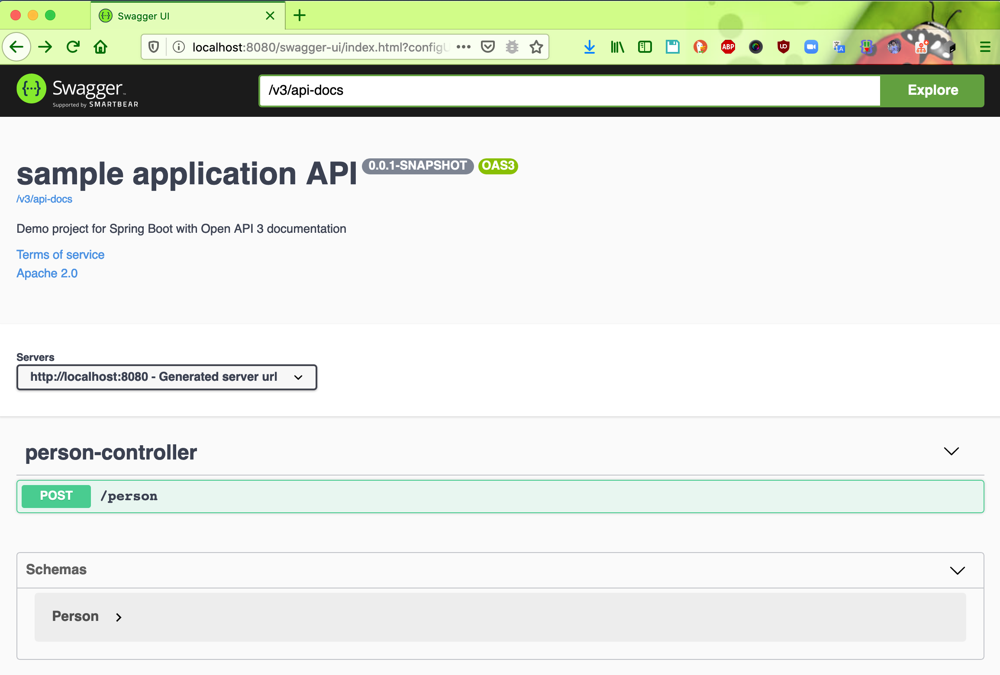
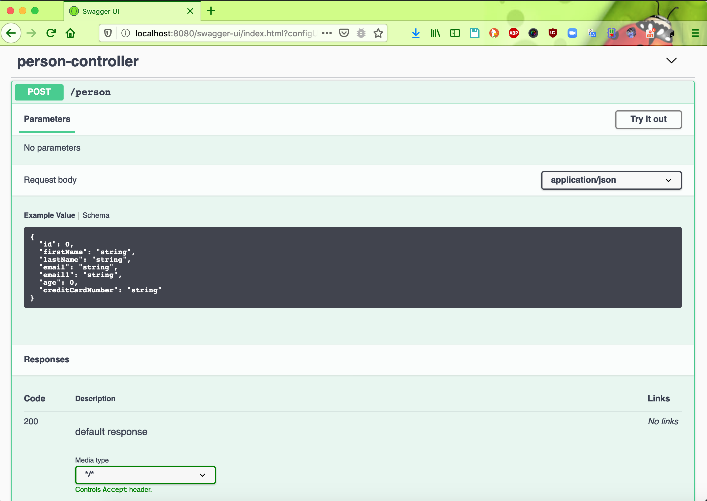
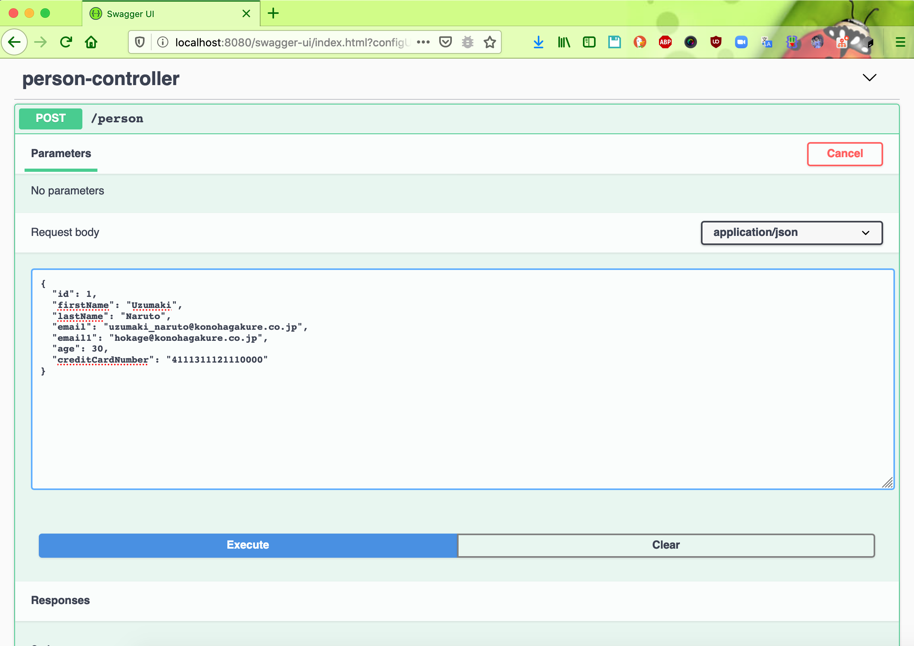
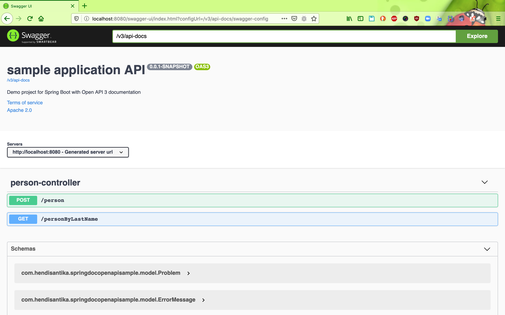
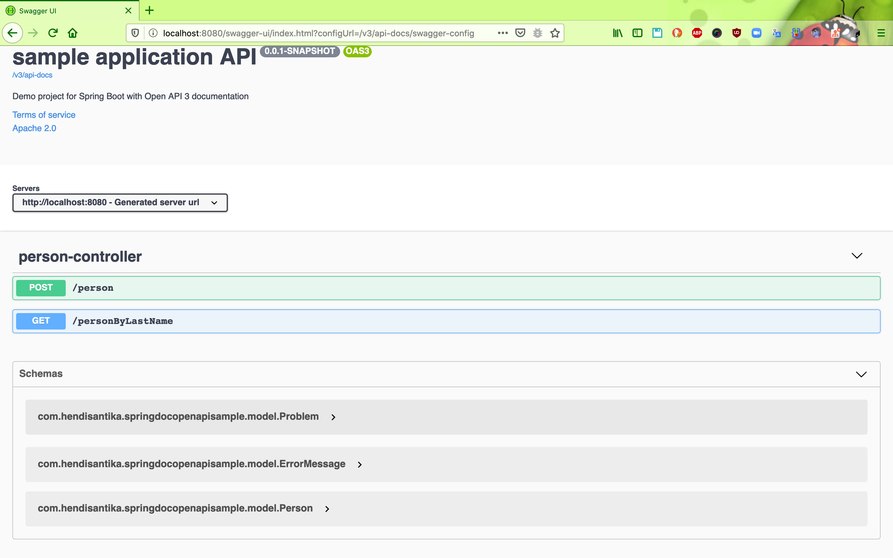

# springdoc-openapi-sample

[](https://github.com/hendisantika/springdoc-openapi-sample/actions/workflows/maven.yml)


Sample Spring Boot application that documents its REST API with [springdoc-openapi](https://springdoc.org/)
(OpenAPI 3.1 + Swagger UI), including Bean Validation constraints and a global error handler.

## Tech Stack

| Component         | Version          |
|-------------------|------------------|
| JDK               | 25 (Temurin)     |
| Spring Boot       | 4.1.2            |
| springdoc-openapi | 3.2.0 (WebMVC)   |
| Maven (wrapper)   | 3.9.16           |
| Lombok            | managed by Boot  |

## Requirements

- JDK 25
- No local Maven needed — use the bundled Maven wrapper (`./mvnw`)

## Things todo list

1. Clone this repository: `git clone https://github.com/hendisantika/springdoc-openapi-sample.git`
2. Go inside the folder: `cd springdoc-openapi-sample`
3. Run the application: `./mvnw clean spring-boot:run`
4. Open your favorite browser:
    - Swagger UI: http://localhost:8081/swagger-ui
    - OpenAPI JSON: http://localhost:8081/v3/api-docs

Build & test:

```shell
./mvnw clean verify
```

## Endpoints

| Method | Path                               | Description                                    |
|--------|------------------------------------|------------------------------------------------|
| POST   | `/person`                          | Create (echo) a person, validated by Bean Validation |
| GET    | `/personByLastName?lastName=xxx`   | Find persons by last name (max 10 characters)  |

Sample request:

```shell
curl -X POST http://localhost:8081/person \
  -H 'Content-Type: application/json' \
  -d '{
    "id": 1,
    "firstName": "Uzumaki",
    "lastName": "Naruto",
    "email": "uzumaki_naruto@konohagakure.co.jp",
    "email1": "hokage@konohagakure.co.jp",
    "age": 30,
    "creditCardNumber": "4111311121110000"
  }'
```

## Configuration

Key properties in `src/main/resources/application.properties`:

```properties
server.port=8081
springdoc.swagger-ui.path=/swagger-ui
springdoc.api-docs.path=/v3/api-docs
springdoc.swagger-ui.operationsSorter=method
```

## CI/CD & Dependency Updates

- **GitHub Actions** (`.github/workflows/maven.yml`): builds and tests with JDK 25 on every push / pull request to
  `master`, and submits the Maven dependency graph to GitHub on pushes to `master`.
- **Dependabot** (`.github/dependabot.yml`): weekly (Monday 05:00 Asia/Jakarta) updates for Maven and GitHub Actions,
  grouped (Spring, springdoc, test libraries, Maven plugins, minor/patch, GitHub Actions) and labeled to keep PRs
  manageable.

## Screen shot

Swagger UI Page



Swagger UI Page - API List



Swagger UI Page - API List 2



Swagger UI Page - API List 3



Swagger UI Page - API List 4


